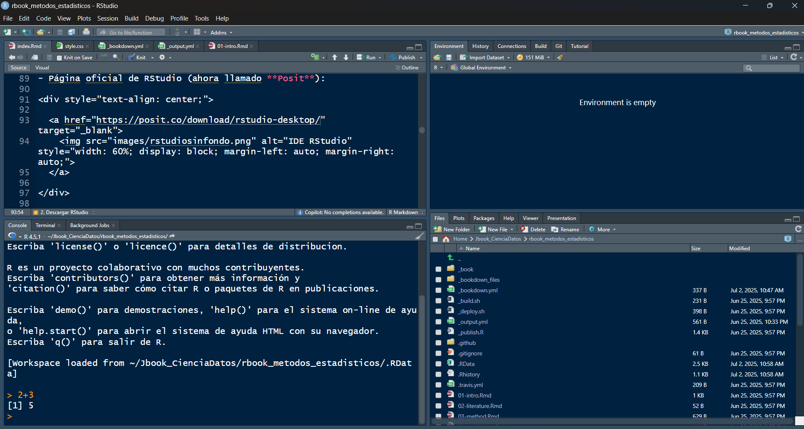
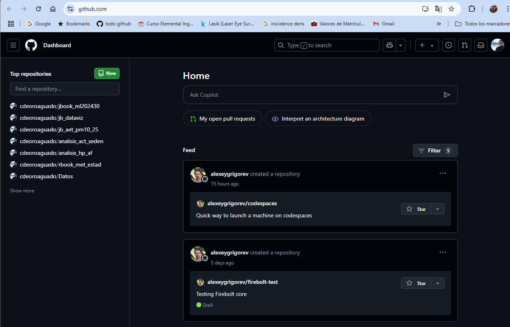
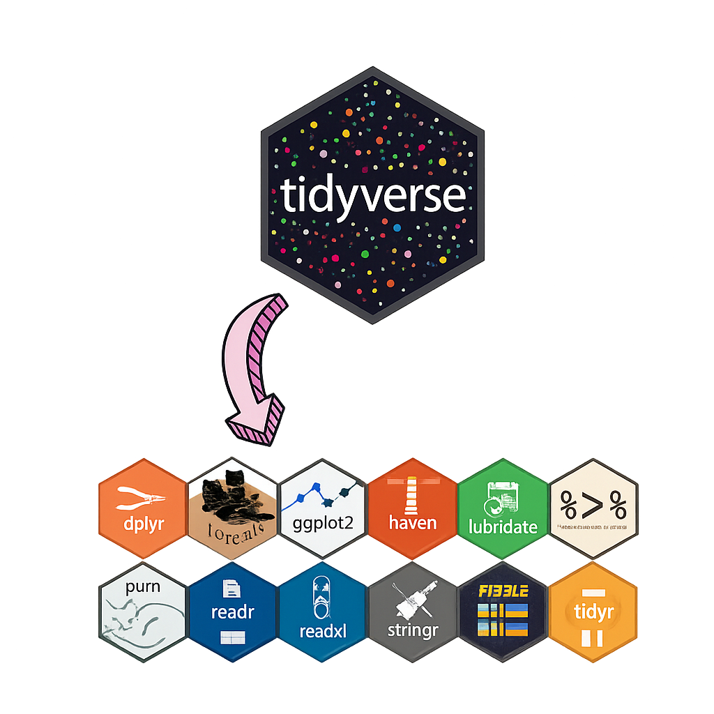

# Introducción {#intro}

## Introducción a R y RStudio

El primer paso para comenzar a trabajar con **R**, un lenguaje de programación especializado en estadística, ciencia de datos y visualización, es instalarlo en tu computadora. **R** es compatible con los principales sistemas operativos, incluyendo **Windows**, **macOS** y **Linux**.

### ¿Qué es R?

**R** es un lenguaje de programación y un entorno de software libre dedicado al análisis estadístico y la generación de gráficos. Su potencia radica en una gran variedad de paquetes estadísticos, su comunidad activa y su capacidad de integración con otras herramientas como Python, SQL, y plataformas de visualización como Power BI o Tableau.

A continuación, se indican los enlaces oficiales para descargar (paso a paso) **R**:

#### Descargar R {#descargar-r .unnumbered}

-   Página oficial del proyecto R (<https://cran.r-project.org>):

```{r rsinfondo, echo=FALSE, fig.cap="Software R", fig.align="center", out.width="30%"}

```

En esta página puedes seleccionar tu sistema operativo:

-   Para Windows: <https://cran.r-project.org/bin/windows/base/>
-   Para macOS: <https://cran.r-project.org/bin/macosx/>
-   Para Linux: <https://cran.r-project.org/bin/linux/>

Se realizará el proceso para la instalación de R para el sistema operativo Windows

```{r inst-r-fig, echo=FALSE, fig.cap="Paso a paso de la instalación de R (izquierda a derecha)", fig.align="center", out.width="48%"}
knitr::include_graphics(c(
  "images/r2.png",
  "images/r3.png",
  "images/r4.png",
  "images/r5.png",
  "images/r6.png",
  "images/r7.png",
  "images/r8.png",
  "images/r9.png"
))
```

### ¿Qué es RStudio?

**RStudio** es un **entorno de desarrollo integrado (IDE)** que proporciona una interfaz gráfica intuitiva y muy funcional para trabajar con R. Entre sus características destacan:

-   Editor de scripts con **resaltado de sintaxis**.
-   Consola interactiva para ejecutar comandos.
-   Panel de visualización de datos y objetos en memoria.
-   Gráficos integrados.
-   Soporte para proyectos y versiones de R.
-   Integración con Git, Markdown, Quarto y Shiny.

Aunque se puede usar R sin RStudio, la mayoría de los usuarios prefieren trabajar dentro de este entorno por su productividad, organización y facilidad de uso.

A continuación, se indican los enlaces oficiales para descargar (paso a paso) **RStudio**:

#### Descargar RStudio {#descargar-rstudio .unnumbered}

-   Página oficial de RStudio (ahora llamado **Posit**, <https://posit.co/download/rstudio-desktop/>):

```{r rs-fig, echo=FALSE, fig.cap="Desarrollo de entorno integrado (IDE) RStudio", fig.align="center", out.width="30%"}

```

Selecciona la versión gratuita de **RStudio Desktop** y descarga el instalador correspondiente a tu sistema operativo.

Se realizará el proceso para la instalación de RStudio para el sistema operativo Windows:

```{r inst-rs-fig, echo=FALSE, fig.cap="Paso a paso de la instalación de RStudio", fig.align="center", out.width="48%"}
knitr::include_graphics(c(
  "images/rs1.png",
  "images/rs2.png",
  "images/rs3.png",
  "images/rs4.png"
))
```

Una vez finalizada la instalación, puedes iniciar RStudio desde el acceso directo en tu escritorio o buscándolo en el menú de inicio.

```{r rs-inst-fig, echo=FALSE, fig.cap="Visualización de RStudio", fig.align="center", out.width="100%"}

```

Al abrir RStudio por primera vez, se presenta un entorno dividido en cuatro paneles:

-   **Script o editor de código** (arriba a la izquierda): donde se escriben los scripts `.R` o `.Rmd`.
-   **Consola** (abajo a la izquierda): donde se ejecutan los comandos directamente.
-   **Entorno / Historial** (arriba a la derecha): muestra los objetos cargados y el historial de comandos.
-   **Archivos, gráficos, paquetes, ayuda y visor** (abajo a la derecha): herramientas auxiliares para explorar y trabajar eficientemente.

Puedes verificar que R y RStudio están funcionando correctamente ejecutando una operación simple en la consola, como:

```{r eval=FALSE}
2 + 3
```

## Introducción a Git y GitHub

### ¿Qué es Git?

**Git** es un sistema de control de versiones distribuido que permite gestionar y registrar los cambios realizados en archivos de un proyecto a lo largo del tiempo. Fue creado por Linus Torvalds y se ha convertido en el estándar para el desarrollo de software y proyectos colaborativos. El enlace es <https://git-scm.com/>.

```{r git-fig, echo=FALSE, fig.cap="Sotfware Git", fig.align="center", out.width="40%"}

```

::: {.admon-box .ventaja}
::: admon-title
[]{.icon} Ventajas principales de Git
:::

-   Permite llevar un **historial detallado** de versiones.
-   Facilita la **colaboración** en proyectos con múltiples personas.
-   Permite trabajar en **ramas** (branches) para desarrollar funcionalidades de forma aislada.
-   No depende de internet para el trabajo local.
:::

#### Pasos para instalar Git

Daremos una guía para la instalación de **Git** usando Windows (paso a paso):

1.  Instalar **Git**:\
    🔗 <https://git-scm.com/downloads>

2.  Ahora, debes realizar lo siguiente:

```{r git-inst-fig, echo=FALSE, fig.cap="Instalación de Git", fig.align="center", out.width="48%"}
knitr::include_graphics(c(
  "images/git1.png",
  "images/git2.png",
  "images/git3.png",
  "images/git4.png"
))
```

3.  A continuación, comprobemos la instalación de Git.

```{r git-inst-b-fig, echo=FALSE, fig.cap="Verificación de Git", fig.align="center", out.width="48%"}
knitr::include_graphics(c(
  "images/gb1.png",
  "images/gb2.png"
))
```

### ¿Qué es GitHub?

**GitHub** es una plataforma en línea que permite alojar repositorios de Git en la nube. Es ideal para compartir proyectos, colaborar en equipo y automatizar flujos de trabajo. Este es el enlace <https://github.com>.

```{r github-fig, echo=FALSE, fig.cap="Plataforma GitHub", fig.align="center", out.width="30%"}

```

::: {.admon-box .ventaja}
::: admon-title
[]{.icon} Funciones principales de GitHub
:::

-   Crear y administrar **repositorios** públicos o privados.
-   Gestionar cambios mediante **pull requests**.
-   Seguir errores o tareas usando **issues**.
-   Crear documentación, páginas web y wikis para los proyectos.
-   Automatizar procesos con **GitHub Actions**.
:::

#### Pasos para instalar GitHub

A continuación, se presenta una guía paso a paso para la instalación de **GitHub** en Windows:

1.  Crear una cuenta en **GitHub**:\
    🔗 <https://github.com>

2.  Ahora, sigue las imagenes:

```{r github-b-fig, echo=FALSE, fig.cap="Registro en GitHub", fig.align="center", out.width="80%"}
knitr::include_graphics(c(
  "images/gh1.png",
  "images/gh2.png"
))
```

Despues haces el proceso de verificación

-   Completa el captcha de seguridad.

-   GitHub puede pedirte que verifiques tu correo electrónico. Revisa tu bandeja de entrada y haz clic en el enlace de confirmación.

3.  Ingresas al enlace <https://github.com> y despues:

```{r github-c-fig, echo=FALSE, fig.cap="Credenciales de verificación en GitHub", fig.align="center", out.width="70%"}
knitr::include_graphics(c(
  "images/gh3.png",
  "images/gh4.png"
))
```

Al ingresar, este sería el inicio

```{r github-d-fig, echo=FALSE, fig.cap="Dashboard de GitHub", fig.align="center", out.width="100%"}

```

4.  A continuación, vamos a descargar **GitHub Desktop** para Windows; para ello debes usar el enlace <https://desktop.github.com/download/>

```{r github-e-fig, echo=FALSE, fig.cap="Credenciales de verificación en GitHub", fig.align="center", out.width="48%"}
knitr::include_graphics(c(
  "images/ghd1.png",
  "images/ghd2.png",
  "images/ghd3.png",
  "images/ghd4.png",
  "images/ghd5.png",
  "images/ghd6.png",
  "images/ghd7.png",
  "images/ghd8.png"
))
```

#### Diferencias claves entre Git y GitHub {#diferencias-claves-entre-git-y-github .unnumbered}

| Git                         | GitHub                             |
|-----------------------------|------------------------------------|
| Herramienta local           | Plataforma en la nube              |
| Administra versiones        | Aloja y comparte repositorios      |
| No requiere internet        | Requiere conexión para sincronizar |
| Se usa desde terminal o IDE | Se accede por navegador o API      |

#### ¿Cómo se relacionan?

-   Git administra tu proyecto **localmente**, guardando versiones y cambios.
-   GitHub actúa como **repositorio remoto**, permitiendo subir (`push`) o descargar (`pull`) cambios desde y hacia otros colaboradores.
-   Juntos permiten trabajar de forma segura, organizada y colaborativa desde distintos lugares.

## Introducción a Tidyverse

El **Tidyverse** es un conjunto de paquetes integrados para el lenguaje de programación R, diseñados con el objetivo de facilitar el análisis de datos de manera estructurada, legible y eficiente. Su filosofía se basa en el concepto de **“datos ordenados” (tidy data)**, donde cada variable es una columna, cada observación una fila, y cada tipo de unidad observacional forma una tabla.

Estos paquetes comparten principios de diseño comunes y una gramática coherente, lo que permite a los usuarios aprender un conjunto de reglas aplicables en todo el ecosistema, aumentando así la productividad y la claridad del código.

### Representación visual del ecosistema Tidyverse

```{r tidy-fig, echo=FALSE, fig.cap="Paquetes de tidyverse", fig.align="center", out.width="50%"}

```

### Principales paquetes del Tidyverse

A continuación se describen los paquetes más representativos que conforman el núcleo del Tidyverse:

------------------------------------------------------------------------

#### 📊 `ggplot2` {#ggplot2 .unnumbered}

Permite la creación de visualizaciones estadísticas sofisticadas mediante la **Gramática de los Gráficos (Grammar of Graphics)**. Con `ggplot2` puedes combinar capas de datos, geometrías, escalas y temas para construir gráficos informativos y estéticamente agradables. Es ampliamente utilizado en análisis exploratorio y comunicación de resultados.

------------------------------------------------------------------------

#### 📂 `dplyr` {#dplyr .unnumbered}

Facilita la manipulación de datos mediante verbos intuitivos como:

-   `filter()` para filtrar filas según condiciones lógicas,
-   `select()` para elegir columnas,
-   `mutate()` para crear o transformar variables,
-   `summarise()` para resumir valores,
-   `group_by()` para operaciones agrupadas.

Trabaja perfectamente con `tibble` y se puede aplicar a bases de datos con `dbplyr`.

------------------------------------------------------------------------

#### 🔄 `tidyr` {#tidyr .unnumbered}

Su propósito es convertir datos desorganizados en un formato “ordenado”. Algunas de sus funciones clave incluyen:

-   `pivot_longer()` y `pivot_wider()` para cambiar el formato de los datos.
-   `separate()` para dividir una columna en varias.
-   `unite()` para fusionar columnas en una sola.

Estas funciones son fundamentales para preparar datos antes del análisis.

------------------------------------------------------------------------

#### 🧾 `readr` {#readr .unnumbered}

Ofrece funciones rápidas y confiables para importar archivos `.csv`, `.tsv`, `.fwf`, entre otros. Es más eficiente que `read.table()` y permite:

-   Importar con `read_csv()`, `read_delim()` o `read_fwf()`.
-   Detectar problemas de formato con `problems()`.
-   Controlar tipos de datos con argumentos explícitos.

------------------------------------------------------------------------

#### 🧵 `stringr` {#stringr .unnumbered}

Simplifica el trabajo con cadenas de texto (caracteres). Proporciona una sintaxis coherente para tareas comunes como:

-   Búsqueda de patrones (`str_detect`, `str_subset`),
-   Manipulación (`str_replace`, `str_sub`, `str_trim`),
-   Conteo (`str_count`),
-   Extracción (`str_extract`, `str_match`).

Ideal para limpiar y procesar textos en análisis de encuestas, redes sociales o nombres de variables.

------------------------------------------------------------------------

#### 🐱 `forcats` {#forcats .unnumbered}

Dedicado al tratamiento de **factores** en R, un tipo especial de variable categórica. `forcats` ofrece funciones para:

-   Reordenar niveles según frecuencia (`fct_infreq()`),
-   Fusionar niveles (`fct_collapse()`),
-   Recodificar (`fct_recode()`),
-   Ordenar según otras variables (`fct_reorder()`).

Útil en análisis estadísticos donde el tratamiento adecuado de las categorías es clave.

------------------------------------------------------------------------

#### 🕒 `lubridate` {#lubridate .unnumbered}

Permite el manejo sencillo de **fechas y horas**. Resuelve uno de los aspectos más complejos en análisis temporal con funciones como:

-   `ymd()`, `dmy()`, `mdy()` para convertir cadenas en fechas,
-   `hour()`, `minute()`, `second()` para extraer componentes,
-   `interval()`, `duration()` y `period()` para trabajar con intervalos de tiempo.

------------------------------------------------------------------------

#### 📊 `haven` {#haven .unnumbered}

Permite importar y exportar archivos desde software estadístico como:

-   **SPSS** (`.sav`, `.zsav`),
-   **Stata** (`.dta`),
-   **SAS** (`.sas7bdat`, `.xpt`).

Esencial para interoperabilidad con datos institucionales y académicos que provienen de otras plataformas.

------------------------------------------------------------------------

#### 📈 `readxl` {#readxl .unnumbered}

Importa archivos de Excel (`.xls`, `.xlsx`) sin necesidad de tener Excel instalado. Las funciones clave incluyen:

-   `read_excel()` para leer hojas completas,
-   `excel_sheets()` para listar las hojas de un archivo.

Ideal para usuarios que reciben datos administrativos, contables o estadísticos en formato Excel.

------------------------------------------------------------------------

#### 🔁 `purrr` {#purrr .unnumbered}

Introduce herramientas de programación funcional en R, permitiendo aplicar funciones a listas o vectores con más control que `lapply()` o `sapply()`. Permite:

-   Iterar con `map()`, `map_df()`, `map_dbl()`, etc.
-   Trabajar con errores mediante `safely()`, `possibly()`.
-   Manipular listas de manera estructurada.

Ideal para automatizar tareas repetitivas.

------------------------------------------------------------------------

#### 📋 `tibble` {#tibble .unnumbered}

Es una versión mejorada de los data frames tradicionales. Entre sus ventajas:

-   Muestra solo las primeras 10 filas y columnas visibles.
-   No modifica automáticamente los nombres de columnas.
-   Trabaja mejor con los flujos de trabajo del Tidyverse.

------------------------------------------------------------------------

### Instalación del Tidyverse en R

Para instalar todos los paquetes del núcleo del Tidyverse, simplemente se ejecuta en la consola de R:

```{r eval=FALSE}
install.packages("tidyverse")
```

## Pasos para publicar un libro `bookdown` en GitHub Pages

Para publicar un libro bookdown en GitHub Pages debes tener lo siguiente:

1.  Pre-requisitos

-   Tener una cuenta en GitHub.

-   Haber creado un repositorio público (ej. metodos_estadisticos).

-   Tener Git instalado y configurado.

-   Tener `R` y `RStudio` instalado y configurado

-   Instalar el siguiente paquete

```{r eval=FALSE}
install.packages("bookdown")
```

-   Tener un proyecto bookdown funcional en tu computadora.

2.  Abre el archivo `_bookdown.yml` y asegúrate de incluir:

```yaml
book_filename: "index"
output_dir: "docs"
```

Esto hace que el libro se renderice en la carpeta docs, que es donde GitHub Pages busca el sitio por defecto.

3.  En RStudio o consola de R, corre:

```{r eval=FALSE}
bookdown::render_book("index.Rmd")
```

4.  Abre la terminal en la carpeta del libro y ejecuta:

```{bash eval=FALSE}
git init
git remote add origin https://github.com/cdeoroaguado/metodos_estadistico.git
git add docs
git commit -m "primer despliegue del libro"
git push -u origin main 
```

5.  Activa GitHub Pages

-   Ve al repositorio en GitHub.

-   Haz clic en `Settings > Pages`.

-   En “Source”, selecciona:

    -   `Branch: main o master`
    -   `Folder: /docs`

-   Guarda los cambios.

6.  Después de unos segundos, tu libro estará disponible en:

::: {.admon-box .nota}
::: admon-title
[]{.icon} Enlace del texto
:::

Dale click en este enlace:

👉 [https://cdeoroaguado.github.io/metodos_estadistico/](https://cdeoroaguado.github.io/rbook_met_estad/)
:::

### Video paso a paso de la publicación del libro en GitHub Pages

Uno de los pasos más importantes al desarrollar un libro con `bookdown` es su publicación en línea, permitiendo el acceso abierto y permanente al contenido. Para ello, `GitHub Pages` se convierte en una herramienta ideal por su facilidad de uso y compatibilidad con proyectos de R. A continuación, se presenta un video tutorial donde se explican paso a paso los procedimientos necesarios para publicar correctamente un libro elaborado en `bookdown` a través de un repositorio en GitHub:

Cabe resaltar que este libro de muestra estamos utilizando el paquete bookdown [@R-bookdown], el cual fue construido sobre R Markdown y knitr [@xie2015]
