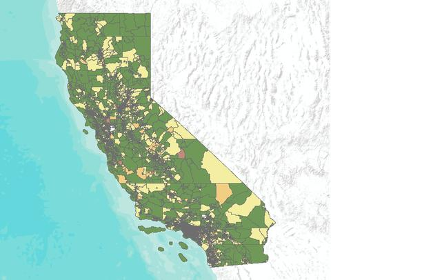

# Análisis exploratorio de datos (EDA) {#eda}

```{r rlibreria, echo=FALSE, fig.cap="Análisis exploratorio de datos (EDA)", fig.align="center", out.width="30%"}

```

```{r r-fig, message=FALSE,warning=FALSE, echo=FALSE}
library(tidyverse)
```

El **Análisis Exploratorio de Datos** (*Exploratory Data Analysis*, EDA por sus siglas en inglés) es una etapa fundamental del proceso estadístico que consiste en utilizar **gráficos, visualizaciones y resúmenes numéricos** para examinar un conjunto de datos.

Su propósito principal es **explorar, descubrir patrones, identificar anomalías y formular posibles hipótesis**, sin realizar inferencias estadísticas formales. El EDA busca **comprender la estructura de los datos** y generar ideas, más que confirmar hipótesis previamente establecidas.

## ¿Cuándo debo utilizarlo?

El **Análisis Exploratorio de Datos (EDA)** es una herramienta poderosa para examinar, comprender y preparar un conjunto de datos. Aunque el análisis esté orientado a hipótesis específicas, el EDA es útil en etapas previas como la limpieza de datos, la detección de errores, el análisis de subgrupos o simplemente para obtener una mejor comprensión de la estructura y comportamiento de los datos.

Uno de los pasos iniciales más importantes del EDA es la **representación gráfica de los datos**, que permite identificar patrones, tendencias y valores atípicos con mayor claridad.

### Tipos de análisis exploratorio:

-   **No gráfico:** Utiliza estadísticas descriptivas para resumir las variables numéricamente.
-   **Gráfico:** Representa visualmente los datos mediante histogramas, diagramas de caja, gráficos de dispersión, entre otros.
-   **Univariado:** Analiza una sola variable a la vez, observando su distribución, tendencia central y dispersión.
-   **Multivariado:** Examina dos o más variables simultáneamente, identificando relaciones o asociaciones entre ellas.

Cada una de estas divisiones puede, a su vez, clasificarse según el tipo de variable involucrada: **categórica** o **numérica**.

## Representación de datos según su naturaleza

La forma en que se representan los datos depende fundamentalmente de su **naturaleza**, es decir, del **tipo de variable** que se está analizando. Esta clasificación influye directamente en la selección de métodos gráficos y estadísticos adecuados para el análisis.

| Naturaleza.de.la.variable | Escala.de.Medidas | Frecuencias | Medidas.de.Localización | Medidas.de.Dispersión | Medidas.de.Distribución | Gráficos                                               |
|:---------|:------|:----|:---------|:--------|:---------|:--------------------|
| Cualitativa               | Nominal           | Sí          | Moda                    | No                    | No                      | Sectores, Barras                                       |
|                           | Ordinal           | Sí          | Moda                    | No                    | No                      | Sectores, Barras (sin orden)                           |
| Cuantitativa              | Intervalo         | Agrupadas   | Media, Mediana y Moda   | Sí                    | Sí                      | Histograma, Tallo y hojas, Cajas y Bigotes, Dispersión |
|                           | Razón             |             |                         | Sí                    | Sí                      |                                                        |

: (\#tab:tipo) Fechas de cortes y distribución de porcentajes

## Presentación y análisis de la información en estudios descriptivos

En los estudios descriptivos, la presentación y análisis de la información constituyen fases clave para comprender las características fundamentales de los datos recolectados. El objetivo principal es **resumir y organizar** la información de forma clara y accesible, sin realizar inferencias ni establecer relaciones causales.

```{r representacion, message=FALSE,warning=FALSE, echo=FALSE}
library(kableExtra)
tabla <- data.frame(
  "Tipo de Tabla" = c(
    "De Frecuencia (Variable Cualitativa)",
    "De Frecuencia (Variable Cuantitativa)",
    "De Asociacion (Dos Variables Cualitativas)",
    "De Asociacion (Una Variable Cualitativa y una Cuantitativa Discreta)",
    "De Asociacion (Una Variable Cualitativa y una Cuantitativa Continua)",
    "De Asociacion (Dos Variables Cuantitativas)"),
  "Tipo de Gráfico" = c(
    "<ul> <li>Barras simples</li> <li>Pastel </li></ul>",
    "<ul> <li>Histograma </li></ul>",
    "<ul> <li>Barras compuestas</li> </ul> <li>Barras superpuestas </li>",
    "<ul> <li>Barras:</li> <li>Compuestas</li> <li>Superpuestas </li></ul>",
    "<ul> <li>Poligono de Frecuencia</li> </ul> <li>Box plot (diagrama de cajas y bigotes) </li>",
    "<ul> <li>Diagrama de Puntos </li></ul>"),
  check.names = FALSE)

kbl(tabla, caption = "Relación entre tipo de tabla y tipo de gráfico", escape = FALSE) |>
  kable_styling(bootstrap_options = c("striped", "hover", "condensed", "responsive"),
                full_width = FALSE) |>
  row_spec(0, bold = TRUE, color = "black", background = "#D9E2F1") |>
  column_spec(1, width = "4cm") |>
  column_spec(2, width = "6cm")
# Nota: código reconstruido a partir del HTML; revisar estilos de filas.
```

## Análisis explotario con variable respuesta numérica

Para el desarrollo de las visualizaciones trabajaremos con el conjunto de datos `California Housing`, un conjunto de datos ampliamente utilizado en ciencia de datos y aprendizaje automático para problemas de regresión. Este conjunto contiene información sobre características demográficas, geográficas y socioeconómicas de distintos sectores censales del estado de California, con el objetivo de analizar y predecir el valor medio de las viviendas a partir de variables como la ubicación, el ingreso medio de los hogares, el número de habitaciones y la densidad poblacional.

```{r r-fig-2, echo=FALSE, fig.cap="Viviendas de California", fig.align="center", out.width="50%"}

```

El conjunto de datos completo puede encontrarse en el repositorio oficial de **Scikit-learn** y en diversas plataformas de ciencia de datos como Kaggle. En este material trabajaremos con una versión del California Housing Dataset, que contiene información de diferentes sectores censales del estado de California. El objetivo principal es predecir el valor medio de las viviendas (`median_house_value`) a partir de variables geográficas, demográficas y socioeconómicas. Entre las variables incluidas se encuentran la longitud y latitud del sector censal, la antigüedad media de las viviendas, el número total de habitaciones y dormitorios, la población, el número de hogares, el ingreso medio de los hogares (`median_income`) y la proximidad al océano (`ocean_proximity`), permitiendo realizar análisis exploratorios y desarrollar modelos de aprendizaje automático para problemas de regresión.

### Contexto de los datos de housing

Aquí tienes una explicación de las variables en el conjunto de datos de housing proporcionado:

Las variables del conjunto de datos son

-   **longitude**: Coordenada de longitud de la ubicación de la vivienda.
-   **latitude**: Coordenada de latitud de la ubicación de la vivienda.
-   **housing_median_age**: Edad media de las casas en la zona.
-   **total_rooms**: Número total de habitaciones en las casas de la zona.
-   **total_bedrooms**: Número total de dormitorios en las casas de la zona.
-   **population**: Población total de la zona.
-   **households**: Número total de hogares en la zona.
-   **median_income**: Ingreso medio de los hogares en la zona (en decenas de miles de dólares).
-   **median_house_value**: Valor medio de las casas en la zona (en dólares).
-   **ocean_proximity**: Proximidad del área al océano.

El objetivo a resolver es predecir el valor medio de las viviendas (`median_house_value`). Sin embargo, antes de construir modelos de regresión multiple, iniciaremos con un análisis exploratorio de datos (EDA) del conjunto California Housing, con el propósito de comprender la estructura de los datos, identificar patrones, detectar valores atípicos y analizar las relaciones entre las variables que pueden influir en el precio de las viviendas.

### Extracción, transformación y carga (ETL)

-   Carguemos el conjunto de datos:

```{r}
url <- "https://raw.githubusercontent.com/cdeoroaguado/Datos/main/dataml/housing.csv"
datos <- read.csv(url)
```

-   Verifiquemos que leímos bien los datos viendo el encabezado y la cola de los datos:

```{r}
head(datos,n=5)
```

Las dimensiones, los nombres de las columnas y la estructura de la base de datos se obtienen con los códigos:

```{r}
dim(datos)
```

```{r}
colnames(datos)
```

```{r}
str(datos)
```

-   Identifiquemos los valores `NA` por columna:

```{r}
df <- datos

df %>%
    dplyr::summarise(across(everything(), ~ sum(is.na(.)), .names = "NA_{.col}"))
```

-   Otra forma de hacerlo es:

```{r}
library(Amelia)
```

```{r na-amelia}
missmap(df)
```

Como tenemos valores ausentes lo vamos a llenar con el promedio

```{r}
df <- df %>%
  dplyr::mutate(
    across(
      where(is.numeric),
      ~ ifelse(is.na(.), mean(., na.rm = TRUE), .)
    )
  )
```

Verifiquemos si fueron llenado son el promedio

```{r}
df %>%
  dplyr::summarise(across(everything(), ~ sum(is.na(.)), .names = "NA_{.col}"))
```

### Análisis de la variable `median_house_value` (Target)

-   Consideremos el resumen estadístico de la variable objetivo `median_house_value`, la cual representa el valor medio de las viviendas en cada zona censal:

```{r}
df %>% 
  dplyr::summarise(
    n = length(median_house_value),
    media = mean(median_house_value),
    ds = sd(median_house_value),
    mediana = median(median_house_value),
    minimo = min(median_house_value),
    maximo = max(median_house_value),
    Q1 = quantile(median_house_value, 0.25),
    Q3 = quantile(median_house_value, 0.75),
    IQR = IQR(median_house_value)
  )
```

La variable `median_house_value` fue analizada a partir de 20.640 observaciones correspondientes a diferentes sectores censales del estado de California. Se obtuvo un valor promedio de las viviendas de aproximadamente $\$206.855,80$ USD (DS = $\$115.395,60$ USD), donde el $50\%$ de los valores registrados se encuentran por debajo de $\$179.700$ USD.

El valor mínimo registrado fue de $\$14.999$ USD, mientras que el máximo alcanzó los $\$500.001$ USD, evidenciando una alta variabilidad en los precios de las viviendas entre las diferentes zonas analizadas. El rango intercuartílico indica que el $50\%$ central de los valores se encuentra entre $\$119.600$ USD y $\$264.725$ USD, con una amplitud de $\$145.125$ USD.

La diferencia entre la media y la mediana sugiere una posible asimetría positiva en la distribución, asociada a la presencia de zonas con valores de vivienda considerablemente elevados. Además, el valor máximo observado coincide con un límite superior del conjunto de datos, por lo que será necesario evaluar posteriormente su posible influencia durante el análisis exploratorio y la construcción de los modelos predictivos.

-   Veamos un histograma

```{r hist-median-house-value}
df %>%
  ggplot(aes(x = median_house_value)) +
  geom_histogram(aes(y = after_stat(density)), 
                 binwidth = 25000, 
                 fill = "#2c7fb8", 
                 color = "white", 
                 alpha = 0.6) +
  geom_density(color = "darkblue", linewidth = 1.2) +
  labs(
    title = "Distribución del valor medio de las viviendas",
    x = "Valor medio de la vivienda (USD)",
    y = "Densidad"
  ) +
  theme_bw()
```

-   Veamos un diagrama de cajas y bigotes

```{r box-median-house-value}
df %>%
  ggplot(aes(x = "", y = median_house_value)) +
  geom_boxplot(fill = "#a6cee3", color = "#1f78b4", outlier.color = "red") +
  stat_summary(
    fun = mean,
    geom = "point",
    shape = 20,
    size = 3,
    color = "black"
  ) +
  labs(
    title = "Diagrama de cajas y bigotes del valor medio de las viviendas",
    x = "",
    y = "Valor medio de la vivienda (USD)"
  ) +
  theme_bw()
```

La distribución de `median_house_value` presenta una asimetría positiva, con una mayor concentración de viviendas en rangos de precios bajos y medios, mientras que una menor proporción de observaciones corresponde a viviendas de alto valor. El histograma y el diagrama de cajas evidencian la presencia de valores atípicos en el extremo superior de la distribución, así como una acumulación de observaciones alrededor de los 500.000 USD, lo que sugiere la existencia de un límite superior impuesto en el conjunto de datos. Esta característica provoca que la media sea superior a la mediana y puede influir en el ajuste de algunos modelos de aprendizaje automático, por lo que será importante considerarla durante las etapas posteriores del análisis y modelamiento.

### Análisis de las variables características (independientes)

Analizaremos el iniciamente las variables numéricas

```{r}
resumen_numericas <- df %>%
  select(where(is.numeric), -median_house_value) %>%
  pivot_longer(
    cols = everything(),
    names_to = "variable",
    values_to = "valor"
  ) %>%
  group_by(variable) %>%
  summarise(
    n = sum(!is.na(valor)),
    media = mean(valor, na.rm = TRUE),
    ds = sd(valor, na.rm = TRUE),
    mediana = median(valor, na.rm = TRUE),
    minimo = min(valor, na.rm = TRUE),
    maximo = max(valor, na.rm = TRUE),
    Q1 = quantile(valor, 0.25, na.rm = TRUE),
    Q3 = quantile(valor, 0.75, na.rm = TRUE),
    IQR = IQR(valor, na.rm = TRUE),
    .groups = "drop"
  )

resumen_numericas
```

```{r dc-var-ind}
library(patchwork)

# Boxplot de housing_median_age
p1 <- df %>%
  ggplot(aes(x = "", y = housing_median_age)) +
  geom_boxplot(fill = "#1f77b4", alpha = 0.7) +
  labs(
    title = "Antigüedad media de las viviendas",
    y = "Años",
    x = ""
  ) +
  theme_bw()

# Boxplot de total_rooms
p2 <- df %>%
  ggplot(aes(x = "", y = total_rooms)) +
  geom_boxplot(fill = "#2ca02c", alpha = 0.7) +
  labs(
    title = "Número total de habitaciones",
    y = "Habitaciones",
    x = ""
  ) +
  theme_bw()

# Boxplot de total_bedrooms
p3 <- df %>%
  ggplot(aes(x = "", y = total_bedrooms)) +
  geom_boxplot(fill = "#d62728", alpha = 0.7) +
  labs(
    title = "Número total de dormitorios",
    y = "Dormitorios",
    x = ""
  ) +
  theme_bw()

# Primera fila
p1 + p2 + p3 
```

```{r dc-var-ind-2}
# Boxplot de population
p4 <- df %>%
  ggplot(aes(x = "", y = population)) +
  geom_boxplot(fill = "#9467bd", alpha = 0.7) +
  labs(
    title = "Población",
    y = "Habitantes",
    x = ""
  ) +
  theme_bw()

# Boxplot de households
p5 <- df %>%
  ggplot(aes(x = "", y = households)) +
  geom_boxplot(fill = "#ff7f0e", alpha = 0.7) +
  labs(
    title = "Número de hogares",
    y = "Hogares",
    x = ""
  ) +
  theme_bw()

# Boxplot de median_income
p6 <- df %>%
  ggplot(aes(x = "", y = median_income)) +
  geom_boxplot(fill = "#8c564b", alpha = 0.7) +
  labs(
    title = "Ingreso medio",
    y = "Ingreso (decenas de miles de USD)",
    x = ""
  ) +
  theme_bw()

# Segunda fila
p4 + p5 + p6
```

::: {.admon-box .ejercicio}
::: admon-title
[]{.icon} Ejercicio
:::

Realizar las gráficas de las otras variables, además la interpretación de la tabla y el gráfico quedan como ejercicio
:::

Ahora analizaremos las variables categóricas

```{r}
# Tabla de frecuencias para ocean_proximity
tabla_ocean <- df %>%
  count(ocean_proximity, name = "Frecuencia") %>%
  mutate(
    Porcentaje = round(Frecuencia / sum(Frecuencia) * 100, 2),
    Variable = "ocean_proximity",
    Categoria = as.character(ocean_proximity)
  ) %>%
  select(Variable, Categoria, Frecuencia, Porcentaje)

tabla_ocean
```

La variable `ocean_proximity` presenta una distribución desigual entre sus categorías. La categoría `<1H OCEAN` concentra el $44.26\%$ de los registros, seguida de `INLAND` con el $31.74\%$, por lo que en conjunto ambas representan el $76.00\%$ de las observaciones. Las categorías `NEAR OCEAN` y `NEAR BAY` corresponden al $12.88\%$ y $11.09\%$, respectivamente, mientras que `ISLAND` representa únicamente el $0.02\%$ de los datos, con tan solo 5 observaciones.

Esta distribución evidencia un desbalance entre las categorías, especialmente en el caso de `ISLAND`, cuya baja frecuencia puede dificultar la estimación confiable de modelos estadísticos. En consecuencia, durante el proceso de modelamiento será necesario considerar este desbalance, ya sea mediante técnicas de codificación adecuadas, agrupación de categorías poco representadas o evaluando el impacto de esta categoría en el desempeño de los modelos.

```{r db-cat-type}
tabla_ocean_b <- df %>%
  count(ocean_proximity, name = "Frecuencia") %>%
  mutate(
    Porcentaje = round(Frecuencia / sum(Frecuencia) * 100, 1),
    Etiqueta = paste0(Frecuencia, " (", Porcentaje, "%)")
  )

ggplot(tabla_ocean_b, aes(x = reorder(ocean_proximity, -Frecuencia), y = Frecuencia)) +
  geom_col(fill = "#008B8B", width = 0.6) +
  geom_text(aes(label = Etiqueta), vjust = -0.5, size = 4.5) +
  facet_wrap(~ "Distribución de la variable ocean_proximity") +
  scale_y_continuous(expand = expansion(mult = c(0, 0.15))) +
  labs(
    x = "Proximidad al océano",
    y = "Frecuencia (Porcentaje)"
  ) +
  theme_bw(base_size = 12) +
  theme(
    plot.title = element_blank(),
    strip.background = element_rect(fill = "gray80", color = NA),
    strip.text = element_text(face = "bold"),
    panel.grid.major.x = element_blank()
  )
```

La categoría `<1H OCEAN` concentra la mayor proporción de observaciones, con $9.136$ registros ($44.3\%$), seguida por `INLAND`, con $6.551$ registros ($31.7\%$). En conjunto, estas dos categorías representan aproximadamente el $76.0\%$ del conjunto de datos. Por otra parte, las categorías `NEAR OCEAN` y `NEAR BAY` corresponden al $12.9\%$ y $11.1\%$ de las observaciones, respectivamente, mientras que `ISLAND` está representada por únicamente 5 registros ($0.02\%$), lo que evidencia un marcado desbalance entre las categorías de la variable `ocean_proximity`.

### Análisis exploratorio bivariado

-   A continuación, analizaremos la relación entre la variable objetivo `median_house_value` y las variables numéricas independientes, con el fin de identificar posibles patrones, tendencias y asociaciones que puedan ser útiles para la construcción de modelos.

```{r disp}
# Diagrama de dispersión: median_house_value vs median_income
df %>%
  ggplot(aes(x = median_income, y = median_house_value)) +
  geom_point(alpha = 0.4, color = "#1E90FF") +
  geom_smooth(method = "lm", formula = y ~ x, se = FALSE, color = "red") +
  labs(
    x = "Ingreso medio",
    y = "Valor medio de la vivienda (USD)"
  ) +
  theme_bw() +
  facet_grid(. ~ "Dispersión entre el ingreso medio y el valor de las viviendas")
```

Los puntos presentan una tendencia ascendente claramente definida, indicando que, a medida que aumenta el ingreso medio (`median_income`) de una zona censal, también tiende a incrementarse el valor medio de las viviendas (`median_house_value`). La mayor concentración de observaciones se encuentra en ingresos medios entre 2 y 6 y valores de vivienda inferiores a $400000$ USD, aunque existe una dispersión considerable para un mismo nivel de ingreso.

Se observa que la variabilidad del precio de las viviendas aumenta conforme crece el ingreso medio, lo que sugiere que en las zonas con mayores ingresos existen viviendas con un rango de precios más amplio. Asimismo, se aprecia una acumulación de observaciones alrededor de los $500000$ USD, correspondiente al límite superior del conjunto de datos, lo que indica un posible efecto de censura en la variable objetivo.

En general, la relación entre `median_income` y `median_house_value` es positiva y aproximadamente lineal, siendo una de las asociaciones más fuertes del conjunto de datos. Esto sugiere que el ingreso medio constituye una variable con un alto poder explicativo para predecir el valor de las viviendas y, por tanto, será un predictor fundamental en la construcción de los modelos de regresión.

::: {.admon-box .ejercicio}
::: admon-title
[]{.icon} Ejercicio
:::

Realiza los diagramas de dispersión de la variable `median_house_value` con respecto a las variables independientes que hacen falta. Analiza e interpreta la relación observada entre estas variables, indicando si existe una tendencia lineal, la presencia de valores atípicos y el grado de asociación con la variable objetivo.
:::

-   Realizaremos la comparación de la variable objetivo median_house_value con respecto a la variable categórica ocean_proximity, con el fin de evaluar si existen diferencias en el valor medio de las viviendas según la proximidad al océano.

```{r}
# Resumen de median_house_value por ocean_proximity
ocean_house <- df %>%
  group_by(ocean_proximity) %>%
  summarise(
    n = length(median_house_value),
    media = mean(median_house_value),
    ds = sd(median_house_value),
    mediana = median(median_house_value),
    minimo = min(median_house_value),
    maximo = max(median_house_value),
    Q1 = quantile(median_house_value, 0.25),
    Q3 = quantile(median_house_value, 0.75),
    IQR = IQR(median_house_value),
    .groups = "drop"
  ) %>%
  mutate(
    variable = "ocean_proximity",
    niveles = as.character(ocean_proximity)
  ) %>%
  select(variable, niveles, everything(), -ocean_proximity)

ocean_house
```

La variable `ocean_proximity` clasifica los sectores censales según su proximidad al océano y presenta cinco categorías. La categoría `<1H OCEAN` concentra el mayor número de observaciones ($44.3%$, $n = 9136$), seguida de `INLAND` ($31.7\%$, $n = 6551$), mientras que `NEAR OCEAN` ($12.9\%$, $n = 2658$) y `NEAR BAY` ($11.1%$, $n = 2290$) representan proporciones menores. La categoría `ISLAND` es prácticamente inexistente en el conjunto de datos, con únicamente 5 observaciones ($0.02\%$), por lo que cualquier conclusión sobre este grupo debe interpretarse con cautela.

Se observan diferencias importantes en el valor medio de las viviendas entre las distintas categorías. Los sectores `ISLAND` presentan el mayor valor promedio de las viviendas $380440$ USD, ($DS = 80559,56$ USD); sin embargo, debido a su reducido tamaño muestral, este resultado no es representativo de la población. Entre las categorías con un número considerable de observaciones, `NEAR BAY` registra el mayor valor medio con $259212,30$ USD, ($DS = 122818,54$ USD), seguida de `NEAR OCEAN` con $249434,00$ USD, ($DS = 122.477,15$ USD) y `<1H OCEAN` con $240084,30$ USD, ($DS = 106124,29$ USD). En contraste, la categoría `INLAND` presenta el menor valor promedio con $124805,40$ USD, ($DS = 70007,91$ USD), lo que sugiere que las viviendas ubicadas en zonas alejadas de la costa tienden a tener precios considerablemente inferiores.

La mediana del valor de las viviendas sigue el mismo comportamiento observado en la media, siendo más elevada en las categorías cercanas al océano y menor en las zonas del interior. Asimismo, las categorías `NEAR BAY` y `NEAR OCEAN` presentan los mayores rangos intercuartílicos ($183200$ USD y $172750$ USD, respectivamente), lo que evidencia una mayor heterogeneidad en los precios de las viviendas. Por otra parte, todas las categorías, excepto `ISLAND`, alcanzan el valor máximo de $500001$ USD, lo que confirma la existencia del límite superior impuesto en la variable median_house_value. En conjunto, estos resultados indican que la proximidad al océano constituye un factor asociado con el valor de las viviendas y, por tanto, esta variable podría aportar información relevante en la construcción de modelos predictivos.

::: {.admon-box .ejercicio}
::: admon-title
[]{.icon} Ejercicio
:::

Realiza el gráfico de dispersión de las variables independientes numéricas y su interpretación.
:::

::: {.admon-box .nota}
::: admon-title
[]{.icon} Paquete `GGally`
:::

El paquete `GGally` es una extensión de `ggplot2` que facilita la creación de gráficos multivariados para análisis exploratorio de datos. Una de sus funciones más utilizadas es `ggpairs()`, que permite visualizar simultáneamente relaciones entre varias variables, tanto numéricas como categóricas, mediante:

-   Diagramas de dispersión (scatterplots),
-   Histogramas o densidades en la diagonal,
-   Correlaciones entre pares de variables numéricas.

Esto es especialmente útil para detectar patrones, asociaciones o valores atípicos en conjuntos de datos con múltiples variables.

Su instalación y carga del paquete

```{r eval=FALSE}
install.packages("GGally")
library(GGally)
```
:::

Modo de uso del paquete `GGally`:

```{r}
library(GGally)
```

```{r ggally}
df %>% 
  ggpairs()
```

::: {.admon-box .ejercicio}
::: admon-title
[]{.icon} Ejercicio
:::

Menciona los errores que puedes encontrar en el gráfico
:::

## Análisis explotario con variable respuesta categórica

### Contexto del conjunto de datos de marketing de un banco

Este conjunto de datos corresponde a **campañas de marketing directo** realizadas por una institución bancaria portuguesa, cuyo objetivo era promover la contratación de **depósitos a plazo fijo** por parte de sus clientes. Las campañas se llevaron a cabo principalmente mediante llamadas telefónicas, y los datos recolectados reflejan tanto características socioeconómicas del cliente como información específica de la interacción comercial.

El conjunto contiene **4521 observaciones** y **17 variables**, entre las cuales se incluyen datos demográficos, financieros y relacionados con el historial de contacto de cada cliente. A continuación se describen las variables:

Estas son las variables

-   **age**: Edad del cliente.\
-   **job**: Profesión del cliente (por ejemplo: desempleado, servicios, gestión).\
-   **marital**: Estado civil del cliente (soltero, casado, divorciado).\
-   **education**: Nivel educativo (primaria, secundaria, terciaria).\
-   **default**: Indica si el cliente tiene crédito en incumplimiento (sí/no).\
-   **balance**: Saldo promedio anual de la cuenta bancaria.\
-   **housing**: Indica si posee préstamo hipotecario (sí/no).\
-   **loan**: Indica si tiene préstamo personal (sí/no).\
-   **contact**: Tipo de comunicación utilizada (celular o fijo).\
-   **day**: Día del mes en que se realizó el último contacto.\
-   **month**: Mes del último contacto.\
-   **duration**: Duración de la última llamada (en segundos).\
-   **campaign**: Número de contactos realizados durante la campaña actual.\
-   **pdays**: Número de días transcurridos desde el último contacto previo (valor -1 indica que no hubo contacto anterior).\
-   **previous**: Número de contactos previos al actual.\
-   **poutcome**: Resultado de una campaña anterior (éxito, fracaso, desconocido).\
-   **y**: Variable objetivo que indica si el cliente **aceptó (yes)** o **no aceptó (no)** contratar un depósito a plazo fijo.

El objetivo principal es **predecir si un cliente aceptará o no un depósito a plazo fijo** (`y`), a partir de sus características personales, financieras y del historial de contactos anteriores. Este análisis permitirá a la entidad financiera **optimizar sus estrategias de marketing**, enfocándose en los perfiles con mayor probabilidad de conversión, reduciendo costos y mejorando la eficiencia de las campañas.

Inicialmente, haremos un análisis exploratorio de los datos.

### Extracción, transformación y carga (ETL)

-   Carguemos el conjunto de datos:

```{r}
url <- "https://raw.githubusercontent.com/cdeoroaguado/Datos/refs/heads/main/datamanip/bank.csv"
datos <- read.csv(url, sep = ";", stringsAsFactors = TRUE)
```

-   Verifiquemos que leímos bien los datos viendo el encabezado y la cola de los datos:

```{r}
head(datos,n=5)
```

Las dimensiones, los nombres de las columnas y la estructura de la base de datos se obtienen con los códigos:

```{r}
dim(datos)
```

```{r}
colnames(datos)
```

```{r}
str(datos)
```

-   Para facilitar el análisis exploratorio y evitar redundancias o ruido en el modelo, se eliminarán las variables `day`, `month` y `previous`.

```{r}
library(tidyverse)

datos %>% 
  select(-day, -month, -previous) -> df
```

```{r}
head(df, n=5)
```

-   Identifiquemos los valores `NA` por columna:

```{r}
df %>%
    summarise(across(everything(), ~ sum(is.na(.)), .names = "NA_{.col}"))
```

-   Otra forma de hacerlo es:

```{r na_amelia_resp_cat}
library(Amelia)

missmap(df)
```

### Análisis de la variable `y` (Target)

-   Consideremos el resumen de la `y`:

```{r}
df %>% 
  count(y) %>% 
  mutate(porcentaje = (n/sum(n))*100)
```

La variable `y` representa el resultado de la campaña de marketing, indicando si el cliente aceptó (`yes`) o no aceptó (`no`) contratar un depósito a plazo fijo. De un total de $4521$ observaciones, el $88.48\%$ de los clientes ($n = 4000$) no aceptaron la oferta, mientras que solo el $11.52\%$ ($n = 521$) sí lo hicieron. Esta distribución refleja un fuerte desequilibrio en los clientes, lo que sugiere que la mayoría de los clientes no están interesados en este producto financiero, y dicho desequilibrio debe considerarse cuidadosamente al construir modelos de predicción.

-   Veamos un diagrama de barras

```{r barras_y}
# Crear tabla de frecuencias para department
tabla_y <- df %>%
  count(y, name = "Clientes") %>%
  mutate(Porcentaje = round(Clientes / sum(Clientes) * 100, 1),
         Etiqueta = paste0(Clientes, " (", Porcentaje, "%)"))

# Gráfico
tabla_y %>% 
  ggplot(aes(x = factor(y), y = Clientes)) +
  geom_col(fill = "#008B8B", width = 0.6) +
  geom_text(aes(label = Etiqueta), vjust = -0.5, size = 3) +
  facet_grid(~ "Distribución de la campaña de marketing (no/yes)") + 
  scale_y_continuous(expand = expansion(mult = c(0, 0.15))) +
  labs(x = "Campaña de marketing", y = "número de clientes (Porcentaje)") +
  #coord_flip() +
  theme_bw(base_size = 14) +
  theme(
    plot.title = element_blank(),
    strip.background = element_rect(fill = "gray80", color = NA),
    strip.text = element_text(face = "bold"),
    panel.grid.major.y = element_blank(),
    axis.text.y = element_text(size = 8)  
  )
```

El gráfico de barras muestra claramente la distribución de respuestas en la campaña de marketing, evidenciando que la gran mayoría de los clientes no aceptaron la oferta del depósito a plazo fijo. Específicamente, el $88.5\%$ de los clientes ($4000$ personas) rechazaron la campaña (`no`), mientras que solo el $11.5'%$ ($521$ personas) decidieron aceptarla (`yes`). Esta marcada diferencia indica un fuerte desbalance en las clases de la variable objetivo, lo cual es relevante al momento de construir modelos predictivos, ya que se requiere considerar técnicas que manejen adecuadamente este desequilibrio para no sesgar el modelo hacia la clase mayoritaria.

### Análisis de las variables características (independientes)

Analizaremos el iniciamente las variables numéricas

```{r}
df %>% 
  summarise(
    n = length(age),
    media = mean(age),
    ds = sd(age),
    mediana = median(age),
    minimo = min(age),
    maximo = max(age),
    Q1 = quantile(age, 0.25),
    Q3 = quantile(age, 0.75),
    IQR = IQR(age)) %>%
  mutate(variable = "age") -> var_num_age

df %>% 
  summarise(
    n = length(balance),
    media = mean(balance),
    ds = sd(balance),
    mediana = median(balance),
    minimo = min(balance),
    maximo = max(balance),
    Q1 = quantile(balance, 0.25),
    Q3 = quantile(balance, 0.75),
    IQR = IQR(balance)) %>% 
  mutate(variable = "balance") -> var_num_bal

df %>% 
  summarise(
    n = length(duration),
    media = mean(duration),
    ds = sd(duration),
    mediana = median(duration),
    minimo = min(duration),
    maximo = max(duration),
    Q1 = quantile(duration, 0.25),
    Q3 = quantile(duration, 0.75),
    IQR = IQR(duration)) %>% 
  mutate(variable = "duration")-> var_num_dur

df %>% 
  summarise(
    n = length(campaign),
    media = mean(campaign),
    ds = sd(campaign),
    mediana = median(campaign),
    minimo = min(campaign),
    maximo = max(campaign),
    Q1 = quantile(campaign, 0.25),
    Q3 = quantile(campaign, 0.75),
    IQR = IQR(campaign)) %>% 
  mutate(variable = "campaign")-> var_num_camp

df %>% 
  summarise(
    n = length(pdays),
    media = mean(pdays),
    ds = sd(pdays),
    mediana = median(pdays),
    minimo = min(pdays),
    maximo = max(pdays),
    Q1 = quantile(pdays, 0.25),
    Q3 = quantile(pdays, 0.75),
    IQR = IQR(pdays)) %>% 
  mutate(variable = "pdays")-> var_num_pdays

bind_rows(var_num_age, var_num_bal, var_num_dur,var_num_camp,var_num_pdays) %>%
  select(variable, everything())
```

El análisis estadístico de las variables numéricas revela características clave de los clientes contactados durante la campaña de marketing. La edad promedio es de $41.17$ años (DS = $10.58$ años), con un rango de $19$ a $87$ años, lo que indica una población adulta diversa. El saldo promedio anual en la cuenta bancaria (`balance`) es de $1422.66$ USD (DS = $3009.64$ USD), evidenciando una alta dispersión y la presencia de valores extremos, desde $-3313$ hasta $71188$ USD. La duración de las llamadas telefónicas presenta un promedio de $263.96$ segundos (DS = $259.86$ segundos), con el $50\%$ de las observaciones por debajo de $185$ segundos y un rango que va desde $4$ hasta $3025$ segundos, lo que sugiere una distribución muy dispersa y posiblemente sesgada. En cuanto al número de contactos durante la campaña (`campaign`), se observa un promedio de $2.79$ contactos (DS = $3.11$), con el $50\%$ de los registros por debajo de $2$ y valores extremos que alcanzan hasta $50$, aunque la mayoría de los clientes fue contactado pocas veces (rango intercuartílico de $P75% = 3$ y $P25% = 1$). Por último, la variable `pdays`, que indica los días transcurridos desde el último contacto en campañas anteriores, tiene una media de $39.77$ días (DS = $100.12$ días), pero con el $50\%$ de los registros y los percentiles $25\%$ y $75\%$ en $-1$, lo que indica que la mayoría de los clientes no había sido contactada previamente, a pesar de que algunos registros superan los $800$ días. Estos datos permiten identificar comportamientos heterogéneos y posibles segmentos dentro de la base de clientes.

```{r dc_var_ind_resp_cat}
library(patchwork)
library(gridExtra)

# Boxplot de age
p1 <- df %>%
  ggplot(aes(x = "", y = age)) +
  geom_boxplot(fill = "#1f77b4", alpha = 0.7) +
  stat_summary(fun = mean, geom = "point", shape = 18, size = 4, color = "black") +
  labs(
    title = "Distribución de la edad",
    y = "Años",
    x = ""
  ) +
  theme_bw()

# Boxplot de balance
p2 <- df %>%
  ggplot(aes(x = "", y = balance)) +
  geom_boxplot(fill = "#2f43b1", alpha = 0.7) +
  stat_summary(fun = mean, geom = "point", shape = 18, size = 4, color = "black") +
  labs(
    title = "Distribución del balance de la cuenta",
    y = "Usd",
    x = ""
  ) +
  theme_bw()

# Diagrama de boxplot para duration
p3 <- df %>%
  ggplot(aes(x = "", y = duration)) +
  geom_boxplot(fill = "#2ca02c", alpha = 0.7) +
  stat_summary(fun = mean, geom = "point", shape = 18, size = 4, color = "black") +
  labs(
    title = "Distribución de la duración de llamada (duration)",
    y = "Segundos",
    x = ""
  ) +
  theme_bw()

# Diagrama de boxplot para campaign
p4 <-df %>%
  ggplot(aes(x = "", y = campaign)) +
  geom_boxplot(fill = "#ff7f0e", alpha = 0.7) +
  stat_summary(fun = mean, geom = "point", shape = 18, size = 4, color = "black") +
  labs(
    title = "Distribución del número de contactos (campaign)",
    y = "Número de contactos",
    x = ""
  ) +
  theme_bw()

# Diagrama de boxplot para pdays
p5 <-df %>%
  ggplot(aes(x = "", y = pdays)) +
  geom_boxplot(fill = "#9467bd", alpha = 0.7) +
  stat_summary(fun = mean, geom = "point", shape = 18, size = 4, color = "black") +
  labs(
    title = "Días desde último contacto en campaña anterior (pdays)",
    y = "Días",
    x = ""
  ) +
  theme_bw()

grid.arrange(p1, p2,p3,p4,p5, ncol = 2,newpage = FALSE)
```

::: {.admon-box .ejercicio}
::: admon-title
[]{.icon} Ejercicio
:::

La interpretación de los gráficos quedan como ejercicio
:::

Ahora analizaremos las variables categóricas

```{r}
# Para job
tabla_job <- df %>%
  count(job, name = "Frecuencia") %>%
  mutate(Porcentaje = round(Frecuencia / sum(Frecuencia) * 100, 2),
         Variable = "job",
         Categoria = job) %>%
  select(Variable, Categoria, Frecuencia, Porcentaje)

# Para marital
tabla_marital <- df %>%
  count(marital, name = "Frecuencia") %>%
  mutate(Porcentaje = round(Frecuencia / sum(Frecuencia) * 100, 2),
         Variable = "marital",
         Categoria = marital) %>%
  select(Variable, Categoria, Frecuencia, Porcentaje)

# Para education
tabla_education <- df %>%
  count(education, name = "Frecuencia") %>%
  mutate(Porcentaje = round(Frecuencia / sum(Frecuencia) * 100, 2),
         Variable = "education",
         Categoria = education) %>%
  select(Variable, Categoria, Frecuencia, Porcentaje)

# Para default
tabla_default <- df %>%
  count(default, name = "Frecuencia") %>%
  mutate(Porcentaje = round(Frecuencia / sum(Frecuencia) * 100, 2),
         Variable = "default",
         Categoria = default) %>%
  select(Variable, Categoria, Frecuencia, Porcentaje)

# Para housing
tabla_housing <- df %>%
  count(housing, name = "Frecuencia") %>%
  mutate(Porcentaje = round(Frecuencia / sum(Frecuencia) * 100, 2),
         Variable = "housing",
         Categoria = housing) %>%
  select(Variable, Categoria, Frecuencia, Porcentaje)

# Para loan
tabla_loan <- df %>%
  count(loan, name = "Frecuencia") %>%
  mutate(Porcentaje = round(Frecuencia / sum(Frecuencia) * 100, 2),
         Variable = "loan",
         Categoria = loan) %>%
  select(Variable, Categoria, Frecuencia, Porcentaje)

# Para contact
tabla_contact <- df %>%
  count(contact, name = "Frecuencia") %>%
  mutate(Porcentaje = round(Frecuencia / sum(Frecuencia) * 100, 2),
         Variable = "contact",
         Categoria = contact) %>%
  select(Variable, Categoria, Frecuencia, Porcentaje)

# Para poutcome
tabla_poutcome <- df %>%
  count(poutcome, name = "Frecuencia") %>%
  mutate(Porcentaje = round(Frecuencia / sum(Frecuencia) * 100, 2),
         Variable = "poutcome",
         Categoria = poutcome) %>%
  select(Variable, Categoria, Frecuencia, Porcentaje)

# Unir todas las tablas
bind_rows(tabla_job, tabla_marital, tabla_education,tabla_default,
          tabla_housing, tabla_loan,tabla_contact, tabla_poutcome)
```

En cuanto al estado civil (`marital`), la mayoría de los clientes están casados ($61.87\%$), seguidos por solteros ($26.45\%$) y divorciados ($11.68\%$), lo que sugiere una base de datos predominantemente compuesta por personas con vínculos conyugales estables. Respecto al nivel educativo (`education`), más de la mitad de los clientes tiene educación secundaria ($51.01\%$), mientras que el $29.86\%$ alcanzó estudios terciarios y el $15.00\%$ solo nivel primario. Un pequeño porcentaje ($4.14\%$) no reporta su nivel educativo. Estos datos permiten identificar patrones demográficos que podrían ser relevantes para el diseño de estrategias de marketing más efectivas según el perfil del cliente.

::: {.admon-box .ejercicio}
::: admon-title
[]{.icon} Ejercicio
:::

Continua interpretando las demas variables.
:::

```{r db_cat_job_resp_cat}
tabla_default_b <- df %>%
  count(default, name = "Frecuencia") %>%
  mutate(Porcentaje = round(Frecuencia / sum(Frecuencia) * 100, 1),
         Etiqueta = paste0(Frecuencia, " (", Porcentaje, "%)"))

tabla_default_b %>% 
  ggplot(aes(x = default, y = Frecuencia)) +
  geom_col(fill = "#008B8B", width = 0.6) +
  geom_text(aes(label = Etiqueta), vjust = -0.5, size = 5) +
  facet_wrap(~ "Distribución de la variable default") +
  scale_y_continuous(expand = expansion(mult = c(0, 0.15))) +
  labs(x = "¿Tiene crédito en incumplimiento?", 
       y = "Frecuencia (Porcentaje)") +
  theme_bw(base_size = 14) +
  theme(
    plot.title = element_blank(),
    strip.background = element_rect(fill = "gray80", color = NA),
    strip.text = element_text(face = "bold"),
    panel.grid.major.x = element_blank()
  )
```

La gráfica muestra la distribución de la variable `default`, que indica si un cliente tiene o no un crédito en incumplimiento de pago. Se observa que el $98.3\%$ de los clientes ($4445$ personas) no tienen incumplimientos, mientras que solo el $1.7\%$ ($76$ personas) sí presentan incumplimientos. Esta marcada desproporción sugiere que la mayoría de los clientes se encuentran al día con sus compromisos financieros, y que el incumplimiento es un evento poco frecuente en la base de datos.

::: {.admon-box .ejercicio}
::: admon-title
[]{.icon} Ejercicio
:::

Realiza los gráficos de las variables independientes categóricas faltantes e interprelas.
:::

### Análisis exploratorio bivariado

-   Realizaremos la comparacion de la variable `y` con respecto a las variables numéricas independientes.

```{r disp_resp_cat}
# Diagrama boxplot: y vs age
df %>%
  ggplot(aes(x = y, y = age)) +
  geom_boxplot(fill = "#1E90FF", alpha = 0.6, color = "black") +
  stat_summary(fun = mean, geom = "point", shape = 20, size = 3, color = "red") +
  labs(
    title = "Distribución de la edad según la respuesta del cliente",
    x = "¿Aceptó el depósito a plazo fijo? (y)",
    y = "Edad del cliente"
  ) +
  theme_bw() +
  theme(
    plot.title = element_text(hjust = 0.5),
    strip.background = element_rect(fill = "gray90", color = NA),
    strip.text = element_text(face = "bold")
  )
```

El grafico muestra la distribución de la edad de los clientes según su respuesta a la campaña de marketing, diferenciando entre quienes no aceptaron (`no`) y quienes sí aceptaron (`yes`) contratar un depósito a plazo fijo. Ambas gráficos muestran un comportamiento similar, donde el $50\%$ de los clientes alrededor de los 40 años o menos en ambos casos. Tambien, se observa que los clientes que aceptaron la oferta tienden a tener un promedio ligeramente superior en comparación con quienes no aceptaron. Esto podría indicar que los clientes de mayor edad muestran una leve mayor disposición a aceptar el producto. En resumen, aunque hay una leve diferencia por edad, esta variable por sí sola no parece explicar completamente la decisión de aceptar el producto.

::: {.admon-box .ejercicio}
::: admon-title
[]{.icon} Ejercicio
:::

Realiza el gráfico boxplot para las variables `balance`, `duration`, `campaing`, `pdays` segun la respuesta de campaña de marketing del banco (`y`) e interprétalos.
:::

-   Realizaremos la comparacion de las variables numéricas independientes con respecto a la variable `y`

```{r}
# Agrupación por 'y'
age_y <- df %>%
  group_by(y) %>%
  summarise(n = length(age),
            media = mean(age),
            ds = sd(age),
            mediana = median(age),
            minimo = min(age),
            maximo = max(age),
            Q1 = quantile(age, 0.25),
            Q3 = quantile(age, 0.75),
            IQR = IQR(age)) %>%
  mutate(variable = "age", niveles = as.character(y)) %>%
  select(variable, niveles, everything(), -y)

balance_y <- df %>%
  group_by(y) %>%
  summarise(n = length(balance),
            media = mean(balance),
            ds = sd(balance),
            mediana = median(balance),
            minimo = min(balance),
            maximo = max(balance),
            Q1 = quantile(balance, 0.25),
            Q3 = quantile(balance, 0.75),
            IQR = IQR(balance)) %>%
  mutate(variable = "balance", niveles = as.character(y)) %>%
  select(variable, niveles, everything(), -y)

duration_y <- df %>%
  group_by(y) %>%
  summarise(n = length(duration),
            media = mean(duration),
            ds = sd(duration),
            mediana = median(duration),
            minimo = min(duration),
            maximo = max(duration),
            Q1 = quantile(duration, 0.25),
            Q3 = quantile(duration, 0.75),
            IQR = IQR(duration)) %>%
  mutate(variable = "duration", niveles = as.character(y)) %>%
  select(variable, niveles, everything(), -y)

campaign_y <- df %>%
  group_by(y) %>%
  summarise(n = length(campaign),
            media = mean(campaign),
            ds = sd(campaign),
            mediana = median(campaign),
            minimo = min(campaign),
            maximo = max(campaign),
            Q1 = quantile(campaign, 0.25),
            Q3 = quantile(campaign, 0.75),
            IQR = IQR(campaign)) %>%
  mutate(variable = "campaign", niveles = as.character(y)) %>%
  select(variable, niveles, everything(), -y)

pdays_y <- df %>%
  group_by(y) %>%
  summarise(n = length(pdays),
            media = mean(pdays),
            ds = sd(pdays),
            mediana = median(pdays),
            minimo = min(pdays),
            maximo = max(pdays),
            Q1 = quantile(pdays, 0.25),
            Q3 = quantile(pdays, 0.75),
            IQR = IQR(pdays)) %>%
  mutate(variable = "pdays", niveles = as.character(y)) %>%
  select(variable, niveles, everything(), -y)

# Unión de todas las tablas
bind_rows(age_y,balance_y,duration_y,campaign_y,pdays_y)
```

::: {.admon-box .ejercicio}
::: admon-title
[]{.icon} Ejercicio
:::

Realiza la interpretación para las variables independientes según `y`.
:::

-   Realizaremos la comparacion de las variables categóricas independientes con respecto a la variable `y`

```{r}
df %>%
  group_by(y) %>%
  count(marital, name = "n") %>%
  mutate(categoria = marital,
    variable = "marital",
    porcentaje = (n / sum(n)) * 100) %>%
  select(y, variable, categoria, n, porcentaje)
```

La distribución del estado civil según la respuesta del marketing muestra diferencias relevantes en los patrones de respuesta. Entre quienes respondieron afirmativamente (`yes`), el $53.17\%$ están casados, el $32.05\%$ solteros y el $14.78\%$ divorciados. En contraste, en el grupo que respondió negativamente (`no`), la mayoría ($63\%$) también está casada, pero la proporción de solteros ($25.73%$) y divorciados ($11.28\%$) es menor. Esta diferencia sugiere que las personas solteras y divorciadas presentan una mayor disposición o probabilidad de responder afirmativamente frente a la acción evaluada por la variable y, mientras que los casados tienden más a rechazarla, lo que podría ser clave para estrategias de segmentación o análisis de comportamiento.

::: {.admon-box .ejercicio}
::: admon-title
[]{.icon} Ejercicio
:::

Realiza las tablas de las variables independientes segun variable respuesta `y`. Interpreta las tablas.
:::

```{r graf_agrup}
df_plot <- df %>%
  group_by(y) %>%
  count(default, name = "n") %>%
  mutate(categoria = default,
    variable = "default",
    porcentaje = (n / sum(n)) * 100) %>%
  select(y, categoria, n, porcentaje)

# Gráfica de barras agrupadas con etiquetas
df_plot %>% 
  ggplot(aes(x = categoria, y = n, fill = y)) +
  geom_bar(stat = "identity", position = position_dodge(width = 0.9)) +
  geom_text(aes(label = paste0(n, " (", round(porcentaje, 1), "%)")),
            position = position_dodge(width = 0.9),
            vjust = -0.3,
            size = 3) +
  labs(title = "Historial de impago (default)",
       x = "Historial de impago (default)",
       y = "Cantidad de clientes"
  ) +
  theme_bw() +
  scale_fill_brewer(palette = "Set1") 
```

::: {.admon-box .ejercicio}
::: admon-title
[]{.icon} Ejercicio
:::

1.  Interpreta la gráfica.
2.  Realiza las demas gráficas con sus respectivas interpretaciones
:::
